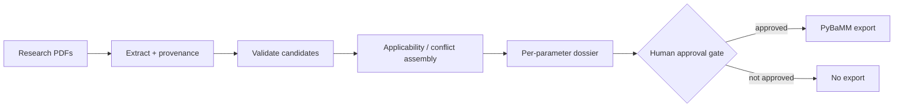

<div align="center">

# PARALLM

**Provenance-grounded parameter assembly for PyBaMM**

> **Literature evidence in; a reviewable PyBaMM parameter set out — with the
> provenance, conflicts and identifiability decisions attached.**

[Docs](https://bruhpika.github.io/ParaLLM-PyBaMM/) · [CLI guide](docs/CLI.md) · [Results](docs/BENCHMARK_RESULTS.md) · [MIT license](LICENSE)

</div>

<p align="center">
  
</p>

**Status:** research prototype — [v0.1.0-beta.1](CHANGELOG.md) released, `v0.2`
in progress. **No experimental validation is claimed.**

PARALLM is a closed-loop research framework for parameterizing physics-based
lithium-ion battery models built on [PyBaMM](https://pybamm.org). Its unit of
work is the **per-parameter dossier**: a researcher must be able to defend every
number in the resulting parameter set from the dossier alone. The LLM is an
evidence interpreter and workflow orchestrator, never an oracle for
electrochemical constants; all numeric decision paths are deterministic.

## How it works



The LLM proposes evidence interpretations; deterministic rules validate units,
quotes, applicability and export eligibility.

## Repository map

| Path | Purpose |
|---|---|
| `src/pybamm_closed_loop/` | Engine, CLI and deterministic decision layers |
| `docs/` | Published documentation site |
| `demos/` | Reproducible VHS terminal recordings |
| `results/` | Committed scientific artifacts and summaries |
| `data/raw_documents/` | Provenance-tracked source documents |
| `benchmarks/`, `configs/`, `scripts/` | Reproducible experiments and run configs |
| `tests/` | Software-correctness tests (science stays in `benchmarks/`) |

## What PARALLM is now (v0.2)

1. **Literature evidence** — ingest documents, retrieve passages (real BM25 over
   the full store, or the probe-based oracle-located path), and extract a value,
   unit, verbatim quote, locator and stated experimental conditions with
   provenance. Deterministic checks never silently invent or substitute values.
2. **Applicability / conflict assembly (V2.1)** — a hand-set, auditable rubric
   scores each candidate against a target cell specification, classifies and
   resolves same-source and cross-source conflicts, and records which rules
   fired. No learned weights in v0.2.
3. **Per-parameter dossier + human approval gate (V2.2)** — nine mandatory
   fields per parameter, rendered as JSON + Markdown + an **approved-only**
   PyBaMM export. Registry writes require deterministic validation and explicit
   human approval (AGENTS.md rule 10); without a gate file the export is empty.
4. **Observability-based CALIBRATE / FIX / MEASURE (V2.3)** — per-parameter
   identifiability from the recorded P2 sensitivity/FIM/Sobol artifacts is
   joined into the dossier and a fit/fix/measure action matrix. Deliberately
   mismatched **synthetic** end-to-end validation (V2.4) tests the workflow;
   the closed loop (V2.6) is gated on V2.1–V2.4 and has not started.

An optimization result is never treated as proof of identifiability, and
synthetic recovery is never treated as experimental validation.

Documentation site: https://bruhpika.github.io/ParaLLM-PyBaMM/ (MkDocs; source
in `docs/`).

## Install

Install the published `v0.1.0-beta.1` wheel from the
[GitHub Release](https://github.com/bruhpika/ParaLLM-PyBaMM/releases/tag/v0.1.0-beta.1)
(PyPI is not used). Package name: `parallm-pybamm` (Python 3.10–3.15 for the
core stack).

```bash
pip install "https://github.com/bruhpika/ParaLLM-PyBaMM/releases/download/v0.1.0-beta.1/parallm_pybamm-0.1.0b1-py3-none-any.whl"
# ecosystem extras (PyBOP / PyProBE-Data / SALib / pypdf / polars), Python 3.10–3.12:
pip install "parallm-pybamm[ecosystem] @ https://github.com/bruhpika/ParaLLM-PyBaMM/releases/download/v0.1.0-beta.1/parallm_pybamm-0.1.0b1-py3-none-any.whl"
# latest development version:
pip install "git+https://github.com/bruhpika/ParaLLM-PyBaMM.git"
```

For a reproducible, pinned developer setup use the lockfiles in `requirements/`
(`core.lock`, `ecosystem-py312.lock`); see `docs/INSTALLATION.md`. Core verified
on CPython 3.14.8; the ecosystem stack (PyBOP 26.10, PyProBE-Data 2.6.1,
PyBaMM 26.8.0.0) on CPython 3.12.16.

## Command-line interface (`parallm`)

`parallm` is a production-oriented frontend to the existing engine. It adds
Typer, Rich and Questionary; it does not duplicate extraction, validation or
calibration logic. Requires Python 3.10–3.15.

```bash
pip install -e .                        # or install from the git URL above
parallm --version
parallm init --workspace ./battery-research
parallm doctor
```

Without installation: `.venv/bin/python -m pybamm_closed_loop --help`.

Core workflow:

| Stage | Command |
|---|---|
| Workspace | `parallm init`, `status`, `project create NAME`, `doctor [--deep]` |
| Evidence | `parallm extract paper.pdf --out DIR --parameter NAME` |
| Validation | `parallm validate candidates.json --documents DIR [--strict]` |
| Provenance | `parallm evidence list/inspect/report`, `parallm explain PARAMETER` |
| Assembly | `parallm assemble --target YAML --registry JSON --out DIR [--gate FILE]` |
| Calibration | `parallm calibrate report`, `parallm calibrate synthetic --config YAML --out DIR` |
| Export | `parallm export --format json\|pybamm --from PATH --output FILE` |
| Simulation | `parallm simulate --config YAML --out DIR` |

Automation: global `--json`, `--quiet`, `--no-color` and `--debug` options go
before the subcommand. JSON output is a single structured envelope; errors are
machine-readable with stable codes and exit statuses.

Extracted values are **candidates**, never automatically validated or
calibrated. Only human-approved parameters reach the export. Synthetic
recovery is not experimental validation, and real-data fitting is deliberately
not exposed. Full reference: `docs/CLI.md`; capability and design notes:
`docs/CLI_CAPABILITY_MATRIX.md` and `docs/CLI_DESIGN_SYSTEM.md`.

### Terminal demonstrations

Reproducible VHS recordings using real repository data — no fabricated results:

<p align="center">
  
  
  
</p>

<p align="center">
  <code>doctor --deep</code> · <code>evidence inspect</code> · <code>validate</code>
</p>

The validation demo uses `examples/candidate_archived.json`, copied verbatim
from the archived P4 extraction output; its `FAILED` unit check is genuine
engine output. Tapes and regeneration instructions are in `demos/`.

## Quickstart

Run these from the repository root after `pip install -e .`. The
`python -m pybamm_closed_loop` form below also works without the console
script. `parallm init --workspace ./battery-research` creates the workspace
directories used by the CLI; no config or gate file is needed to run the
examples below.

```bash
# Reproducible P0 baseline (DFN, Chen2020, 1C discharge to 2.5 V)
.venv/bin/python scripts/run_baseline.py --config configs/baseline_dfn.yaml --out results/baseline

# Synthetic parameter recovery (ecosystem env)
.venv-ecosystem312/bin/python benchmarks/parameter_recovery/run_recovery_benchmark.py \
  --config configs/p2/recovery_single_1C.yaml --out results/p2/recovery_single

# Offline literature extraction benchmark (no API key)
.venv-ecosystem312/bin/python benchmarks/p3/run_extraction_benchmark.py --provider offline

# Assemble per-parameter dossiers. Without --gate the approved export is empty
# by design; add --gate FILE only after recording explicit human approvals.
.venv/bin/python -m pybamm_closed_loop assemble \
  --target configs/v2/target_lgm50.yaml \
  --registry data/registry/registry.json \
  --out reports/assembly \
  --documents data/raw_documents \
  --p2-results results/p2

# Core software scope (no benchmark or characterization tests)
.venv/bin/python -m pytest -q -m "not benchmark and not characterization"
```

Expected outputs and limitations: `docs/QUICKSTART.md`. **The full default suite
measured 583 passed, 8 skipped on `main` (2026-11-24) in the core `.venv`
(CPython 3.14.10).** Benchmark tests are opt-in via `-m benchmark`.

## Results

Every number in this section is from a committed file under `results/`, cited
next to it. **`oracle-located` is a location oracle, not retrieval and not a
performance upper bound**: evidence is located using the fixture's probe, but
the arm sees only a single small probe window. In the v4 offline side-by-side
the oracle compact arm supplies a mean **561 chars** against **43,371** (BM25
baseline) and **45,640** (tuned BM25) — about **81x less evidence** — so oracle
value accuracy is not a ceiling
(`results/v2/retrieval_improvement/offline_side_by_side_v2.md`). Real BM25
retrieval builds its query only from item facets (v3) or parameter name/unit
(v4) and searches the complete document store; no probe, target-document filter
or gold condition enters the query or evidence selection.

**v3 — oracle-located vs real BM25, same deterministic extractor** (37 items,
all split; source `results/p5/benchmark_v3/summary.md`, "deterministic offline"
rows):

| metric | oracle-located (probe window; not an upper bound) | real retrieval (BM25) |
|---|---:|---:|
| parameter identification | 0.500 | 0.846 |
| value extraction | 0.500 | 0.386 |
| provenance | 1.000 | 0.773 |
| false extraction | 0.000 | 0.195 |
| qualifier classification | 0.115 | 0.614 |
| unit accuracy | 0.769 | 0.636 |
| condition completeness | 0.000 | 0.000 |
| abstention accuracy | 1.000 | 0.167 |

The same source reports the **oracle-located LLM arm** (`retrieval_strict`,
3 repeats, mean ± std): value extraction 0.946 ± 0.022, provenance
0.928 ± 0.026, parameter identification 0.718 ± 0.009, condition completeness
0.116 ± 0.011 (weak), false extraction 0.000 ± 0.000. The LLM real-retrieval
arm is implemented but **not run**, so no LLM oracle-vs-real extraction
comparison is claimed.

**Gold-passage recall@k (real BM25)** — sources
`results/p5/benchmark_v3/retrieval_recall.md` and
`results/v2/v4/retrieval_recall.md`:

| k | v3 (37 items) | v4 (30 items, 3-paper corpus) |
|---:|---:|---:|
| 1 | 0.189 | 0.300 |
| 3 | 0.351 | 0.867 |
| 5 | 0.459 | 0.900 |
| 10 | 0.486 | 1.000 |

v4's higher recall is an **easy setting** (a three-paper corpus); it is not
evidence that retrieval quality generalises. With all ingested documents added
as distractors (10 documents instead of 4), v4 recall@k falls to
**0.000 / 0.167 / 0.367 / 0.767** at k = 1 / 3 / 5 / 10
(`results/v2/v4/retrieval_recall_distractors.md`).

**v0.2 scientific results.** Applicability decision agreement **0.958** on 24
**owner-reviewed** cases (2026-11-20; `results/v2/applicability/summary.md`).
Private v4: condition-field accuracy 0.144 / 0.294 / 0.310 and invented-condition
rate 0.067 / 0.200 / 0.058 for compact/expanded/v25 (`results/v2/v4/summary.md`).
The deterministic **association discipline** (conditions must be supported in
the value's local scope, not just somewhere in the passage) halves the
invented rate — 0.108 → **0.044** on all 30 items, 0.120 → 0.067 on the held-out
test half (rules frozen on dev, test evaluated once) — with condition accuracy
flat (`results/v2/v4_association*/summary.md`; design
`docs/V2_PRIVATE_V4_BENCHMARK.md` §4.2/§7.6).
V2.4 held-out RMSE 4.4 ± 0.1 mV (baseline) → 1.1 ± 0.1 mV (positive control) →
4.4 ± 0.1 mV (negative control), reproduced on 5/5 seeds — **SYNTHETIC**, not
experimental validation (`results/v2/synthetic_validation/summary.md`; figure
`results/v2/synthetic_validation/heldout_rmse.png`). A harder
mismatch run (different solver/tolerances/mesh, an unfitted-parameter
perturbation, three drawn truths, two noise levels, 18 runs) gives held-out RMSE
mean ± std [min, max] in V: baseline 0.0026 ± 0.0004 [0.0019, 0.0033], positive
0.0018 ± 0.0008 [0.0009, 0.0035], negative 0.0026 ± 0.0004 [0.0019, 0.0033];
positive beats baseline 15/18 and negative does not 18/18 — also **SYNTHETIC**
(`results/v2/synthetic_validation_mismatch/summary.md`).

## Limitations

- **No independent experimental validation.** Synthetic parameter recovery ≠
  experimental validation; a successful optimization ≠ identifiability.
  Calibration and validation data must stay disjoint.
- The only end-to-end validation is **synthetic mismatch**: deliberately
  perturbed ground truth and synthetic measurements (V2.4). Real-data claims
  stay blocked until an eligible dataset is licensed and audited.
- The private v4 corpus, fixture and per-item results are **not published**, so
  those numbers cannot be reproduced by outsiders; only the harness, scorer and
  aggregates are public.
- The v4 scorer (protocol-context fix) and the fixture's chemistry gold labels
  were **revised after the first results were seen** — v4 was not pre-registered.
- Observability covers **only the protocols recorded in `results/p2/`**
  (0.5C/1C/2C discharge; 1C and 0.5C+1C+2C synthetic fits). Other parameters are
  explicitly `not_assessed`, never silently fitted.
- Experimental-condition extraction is weak (v3 retrieval condition completeness
  0.116 all / 0.035 eval, same source as the v3 table above); an eligible
  Chen2020-aligned 25 °C multi-rate validation dataset is unresolved.
- The rubric is hand-set (no learned weights). Expert labels were owner-reviewed
  on 2026-11-20, so the 0.958 agreement is final for this set; the set is small
  (24 cases, 2 ambiguous), so subclass figures are descriptive.

Full disclosure: `docs/SCIENTIFIC_LIMITATIONS.md`.

## Data and third-party licences

**The repository's MIT `LICENSE` covers PARALLM code only**, not third-party
documents, papers or datasets. Source terms and provenance are recorded in
`docs/DATA_PROVENANCE.md` and `data/raw_documents/p5_sources/acquisition_manifest.json`.

| document / data | licence (evidence) | text in this repo |
|---|---|---|
| Chen2020 article, JES 167 080534 (doi `10.1149/1945-7111/ab9050`) | **CC BY-NC-ND 4.0** (verified in the PDF text, 2026-11-22; verbatim statement in `docs/DATA_PROVENANCE.md`) | **Not tracked** — owner reversed the tracking decision 2026-11-22 over licensing concerns; supply the PDF locally and verify with `scripts/fetch_chen2020.py` (blob remains in git history from `b6c2b36`) |
| Chen2020 supplementary information | No licence evidence (ECS ©, permission unverified) | **Not tracked** — PDF and derived text/segments acquired locally; see `data/raw_documents/chen2020_supplement/ACQUISITION.md` |
| Laue et al. 2021 | **CC BY 4.0** (licence quote + sha256 verified in the manifest) | Tracked PDF and derived text/segments |
| Dessantis et al. 2023 | **CC BY 4.0** (verified) | Tracked PDF and derived text/segments |
| Goussian et al. 2024 | **CC BY 4.0** (verified) | Tracked PDF and derived text/segments |
| PyBaMM parameter-sets docs snapshot | PyBaMM code is **BSD 3-Clause** (verified from installed PyBaMM 26.8.0.0 `LICENSE.txt`); no explicit licence evidence for the docs snapshot | Tracked snapshot with source URL/retrieval metadata |
| LG M50 sample data (PyProBE) | **UNRESOLVED** upstream licence | Gitignored, not in the repo |

Git history still contains the previously tracked Chen2020 article and
supplement full texts; the repository owner decides whether to purge that
history. No history rewrite was performed here.

## Citing

See `CITATION.cff`. Software citation: PARALLM v0.1.0-beta.1 (2026); v0.2 is in
progress. AI-assistance disclosure and acknowledgements are recorded in the
repository's documentation.

## Author / ownership

**Harshith Bhardwaz Kenkary** — owner and maintainer of PARALLM.<br>
GitHub: [@bruhpika](https://github.com/bruhpika) · Email: harshithkenkary@gmail.com

PARALLM code is MIT-licensed; third-party documents and datasets retain their
own licences as recorded above.
